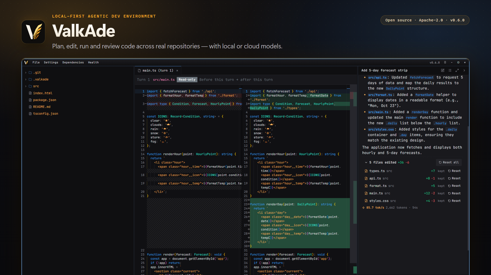
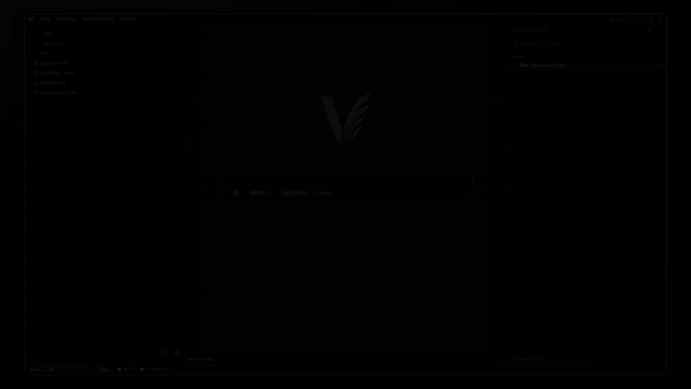
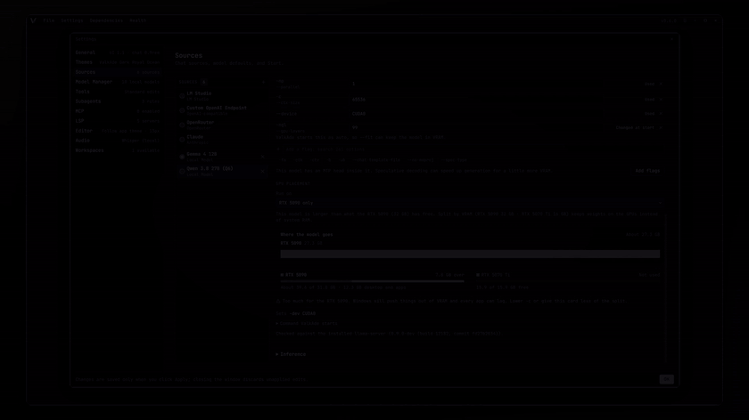
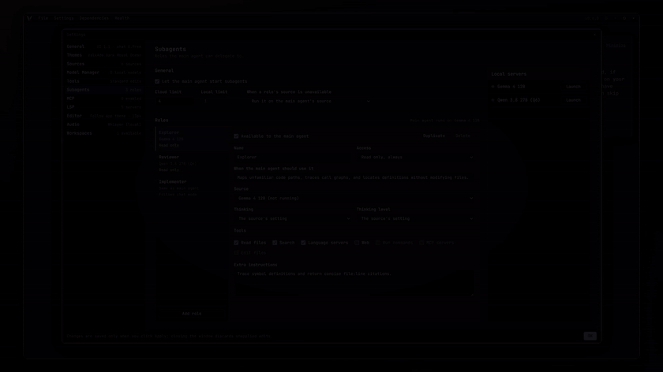
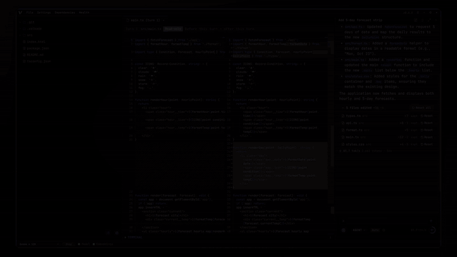
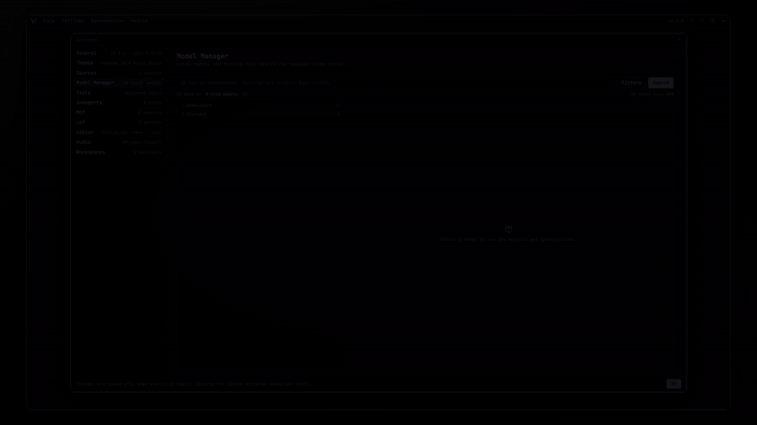
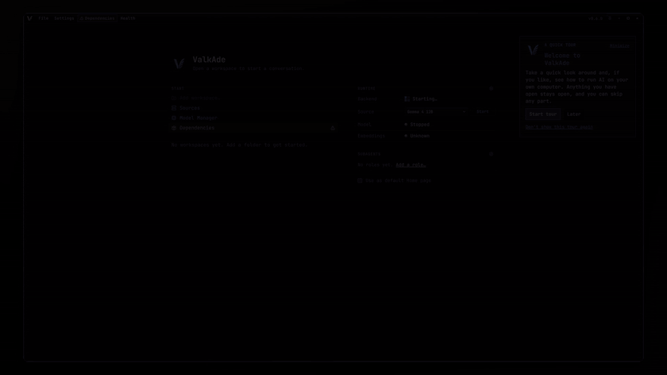
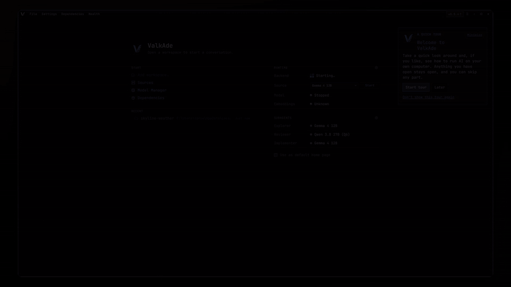

  

  
  

<h3 align="center">Your local-first agentic dev environment.</h3>

Plan, edit, run, and review code across real repositories — with local GGUFs or cloud models. Formerly ClaraCoder.

  <a href="https://github.com/valkade/valkade/releases/latest"><b>Download for Windows</b></a> ·
  <a href="BUILDING.md">Build from source</a> ·
  <a href="THEMES.md">Themes</a> ·
  <a href="docs/media/README.md">Press kit</a>

  
   Gemma 4 12B running locally on an RTX 5070 Ti (81 tok/s). Streaming waits sped up.

---

## What's New in v0.6

### Interactive multi-GPU placement

See exactly where model weights land across every CUDA card. Switch between single-card or split execution, drag the layer split handle live, and watch per-card VRAM gauges and `--tensor-split` flags update in real time.

### Sub-agent roles & live server health

Define specialized sub-agent roles — such as read-only explorers, diff reviewers, or parallel implementers — with per-role tool permissions and separate local or cloud models. Monitor GPU telemetry and live `llama-server` consoles right inside **Health**.

---

## Features

### Review and reset

Every editing turn tracks exact before-and-after snapshots. Open any edited file as a read-only diff, keep what you like, or undo a single file or the entire turn in one click.

### Local models & Hugging Face Model Manager

Browse curated Featured models or search Hugging Face directly, compare GGUF quantizations, pause and resume downloads, and run locally via managed `llama-server`.

Or connect **Claude**, **OpenAI**, **OpenRouter**, **LM Studio**, or any OpenAI-compatible endpoint.

### Cross-window guided tour

First launch includes an optional walkthrough across Home, Dependencies, Model Manager, and Sources. Skip or resume any part whenever you like.

### Built-in signed updates

Click the version label in the title bar to browse stable or beta releases, read release notes, and update in place. Every Windows installer is hash- and signature-verified before it runs.

### Also included

| | |
| - | - |
| **Agent tools & Plan Mode** | Multi-file edit, ripgrep search, shell, web capture, MCP, sub-agents, and Plan Mode that asks clarifying unknowns before writing code |
| **Multi-language LSP** | Built-in TypeScript/JS (`vtsls`), Rust (`rust-analyzer`), Java (`JDT LS`), Python, GDScript, and cross-file symbol rename |
| **Focused workspace layout** | Chat fills the main panel until a file opens; finished turns fold tool runs behind a single clean pill |
| **Semantic search** | Local embedding index to search repositories by intent, completely offline |
| **Theme engine** | Scoped CSS & token theme engine with built-in themes, or [ask ValkAde to design one](THEMES.md) |
| **Health & Dependencies** | Live GPU, VRAM, CPU, per-server `llama-server` consoles, and on-demand runtime installs |

---

## Install

**Windows:** [download the signed installer](https://github.com/valkade/valkade/releases/latest). Everything is bundled. Add a cloud or local model under **Sources** and go.

**macOS and Linux:** [build from source](BUILDING.md).

**Coming from ClaraCoder?** On first launch ValkAde offers to bring over your settings, chats, and workspaces from the old `clara-coder` app-data folder. It copies them only if you accept, and keeps the old folder as a backup. Models stay where they are: an existing `~/ClaraCoder/models` keeps being used, and new installs default to `~/ValkAde/models`. See [BUILDING.md](BUILDING.md#app-data-and-upgrading-from-claracoder) for details.

---

[Build from source](BUILDING.md) · [Themes](THEMES.md) · [Press kit](docs/media/README.md) · [Apache-2.0](LICENSE) ([notice](NOTICE))
